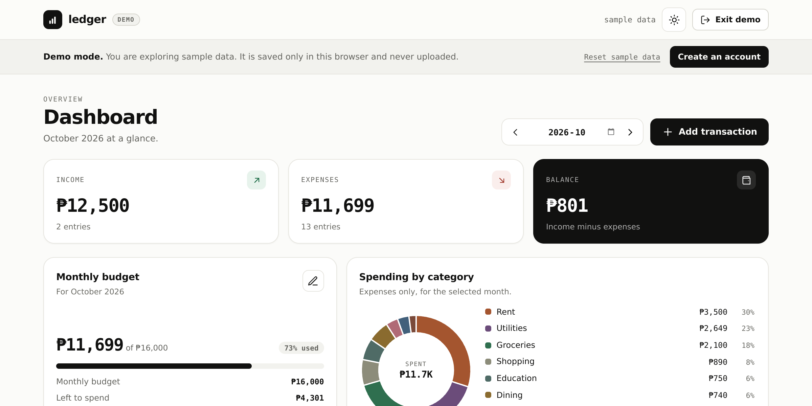

# Ledger — a personal expense tracker

A small, focused expense tracker for logging income and spending, setting a monthly budget, and seeing where the money went. It is built with **plain HTML, CSS and JavaScript** (ES modules), **Supabase** for auth and Postgres, and **Chart.js** for the category breakdown — with **no framework and no build step**.



**Live app:** <https://101dave.github.io/EbaleAllanDave/expense-tracker/>  
**Try it without an account:** <https://101dave.github.io/EbaleAllanDave/expense-tracker/?demo=1>

---

## What it does

- **Accounts** — email/password sign-up, log in, log out, and email confirmation through Supabase Auth.
- **Transactions** — add, edit and delete income or expenses with an amount, category, date and optional note.
- **Monthly dashboard** — income, expenses and balance for the selected month, plus entry counts.
- **Budget** — one optional spending limit per month, with a progress bar and an over-budget state.
- **Filters** — narrow the list by month, type and category.
- **Category chart** — a Chart.js doughnut whose legend doubles as the value table.
- **Demo mode** — a fully interactive sample workspace stored only in the browser, so visitors never have to type real financial information.
- **Interface** — responsive desktop/mobile layouts, light and dark themes, keyboard-friendly dialogs, visible focus states and live-region announcements.
- **States** — dedicated loading, empty, success (toasts), validation and network-error screens.

## Tech stack

| Layer | Choice |
| --- | --- |
| Markup / styles | Hand-written HTML and one CSS design system |
| Behaviour | Vanilla JavaScript, native ES modules |
| Auth and data | Supabase Auth + Postgres via `supabase-js` |
| Security | Row Level Security policies; publishable key only |
| Chart | Chart.js 4 (UMD build from jsDelivr) |
| Fonts | Geist and Geist Mono from Google Fonts |
| Hosting | Any static host (GitHub Pages, Vercel, Netlify) |

There is no `package.json`, bundler or transpiler in the app — the tests are the only Node dependency.

## Project structure

```text
expense-tracker/
├── index.html            app shell, dialogs, SVG icon sprite
├── favicon.svg
├── css/
│   └── styles.css        tokens, layout, components, dark mode, responsive rules
├── js/
│   ├── config.js         Supabase URL/key, currency, demo + portfolio settings
│   ├── supabase.js       creates the browser client (or null when unconfigured)
│   ├── app.js            boot, session routing, theme, sign-out, boot failure
│   ├── auth.js           login/signup panel, validation, password reveal
│   ├── dashboard.js      dashboard state, rendering, filters, charts, dialogs
│   ├── store.js          Supabase store + localStorage demo store
│   ├── format.js         currency, percentages and UTC-safe date helpers
│   ├── categories.js     the category list and chart colours
│   ├── demo-data.js      deterministic sample month used by demo mode
│   ├── chart.js          Chart.js doughnut lifecycle
│   └── ui.js             DOM helpers, dialogs, toasts, focus management
├── sql/
│   └── schema.sql        tables, index, triggers, RLS policies, grants
├── tests/
│   ├── format.test.mjs
│   └── store.test.mjs
└── docs/
    ├── architecture.md
    └── security.md
```

## Run it locally

From the **repository root**:

```bash
python3 -m http.server 8000
```

Then open <http://localhost:8000/expense-tracker/>. Any static server works; opening `index.html` directly with `file://` does not, because ES modules and the email-confirmation redirect need an HTTP origin.

No install, build or watch step. Edit a file and refresh.

## Supabase configuration

The checkout ships with a working Supabase project so the portfolio demo is live. For your own deployment, create a project and point the app at it.

### 1. Create the database objects

1. Create a project at <https://supabase.com/dashboard>.
2. Open **SQL Editor → New query**.
3. Paste the contents of [`sql/schema.sql`](sql/schema.sql) and run it.

The script is idempotent: it creates `public.transactions` and `public.budgets`, an index, `updated_at` triggers, enables Row Level Security, revokes the `anon` role's table privileges, and recreates the eight owner-only policies by name.

### 2. Put the URL and publishable key in `js/config.js`

| Setting | Where it is used |
| --- | --- |
| `SUPABASE_URL` | `js/config.js` → exported to `js/supabase.js` |
| `SUPABASE_ANON_KEY` | `js/config.js` → exported to `js/supabase.js` |
| `CURRENCY`, `LOCALE` | `js/config.js` → `Intl.NumberFormat` in `js/format.js` |
| `DEMO_ENABLED` | `js/config.js` → shows/hides the demo button |
| `PORTFOLIO_URL` | `js/config.js` → auth-screen and footer links |

Copy them from **Supabase Dashboard → Project Settings → API**:

```js
export const SUPABASE_URL = 'https://YOUR_PROJECT_REF.supabase.co';
export const SUPABASE_ANON_KEY = 'sb_publishable_…'; // or the legacy anon key
```

`supabase-js` is imported through an import map in `index.html` and instantiated once in `js/supabase.js`:

```html
<script type="importmap">
  { "imports": { "@supabase/supabase-js": "https://cdn.jsdelivr.net/npm/@supabase/supabase-js@2.57.4/+esm" } }
</script>
```

> **Only the publishable/anon key belongs in the browser.** It is designed to be public; RLS is what protects the rows. Never place a `service_role` or secret key in this folder. `js/supabase.js` sets `persistSession`, `autoRefreshToken` and `detectSessionInUrl`, stores the session under `ledger.auth`, and disables the app with a plain-language setup notice when the URL or key is missing.

### 3. Configure auth URLs

In **Authentication → URL Configuration**:

- **Site URL:** the deployed app URL, e.g. `https://your-app.vercel.app/`
- **Redirect URLs:** every origin/path that may confirm a sign-up, including:
  - `http://localhost:8000/**` for local development
  - `https://your-app.vercel.app/**` for production

`getRedirectUrl()` in `js/app.js` sends the current origin + path as `emailRedirectTo`. If the URL is not allow-listed, the confirmation email will fall back to the Site URL.

Email confirmation is **on** in the bundled project, so a new account must confirm its address before logging in. Turn it off under **Authentication → Providers → Email** for quicker local testing. The client enforces 8 characters; raise **Authentication → Policies → Minimum password length** to 8 on your own project to match.

### 4. Security model in one paragraph

Every row carries a `user_id` that defaults to `auth.uid()` and cascades from `auth.users`. Each table has four policies (`select`, `insert`, `update`, `delete`) whose `using`/`with check` expression is `(select auth.uid()) = user_id`; the `anon` role has no table privileges at all. The app never sends a user id it does not own on insert, and even a forged id is rejected by the `with check` clause. Details and the verification results are in [`docs/security.md`](docs/security.md).

## Demo mode

Append `?demo=1` or choose **Explore the demo** on the sign-in screen. The demo:

- seeds a realistic current month, a previous month with a budget and a month before that without one;
- runs every dashboard interaction — add, edit, delete, budget, filters, chart, theme — against an in-memory copy of `localStorage` (`ledger.demo.v2`);
- never calls Supabase and never uploads anything;
- can be reset with **Reset sample data**, and leaves via **Create an account** or **Exit demo**.

It is a local demo, not a shared sandbox: edits are visible only in that browser profile, and clearing site data resets them.

## Deploy to Vercel

The app is a static site with no build step.

1. Push the repository to GitHub.
2. In Vercel, **Add New → Project** and import it.
3. Set **Root Directory** to `expense-tracker`, **Framework Preset** to *Other*, and leave the build command empty. Output directory: `.` (or leave the default).
4. Deploy, then add `https://<project>.vercel.app/**` to the Supabase redirect allow-list and update the Site URL.
5. If the app is deployed on its own domain, set `PORTFOLIO_URL` in `js/config.js` to the full portfolio URL, or to `''` to hide the portfolio links.

Deploying the whole repository (portfolio + app) to one host also works: the app simply lives at `/expense-tracker/`. That is how the GitHub Pages deployment is set up, and the checked-in `PORTFOLIO_URL = '../PROJECTS.html'` assumes that layout.

## Tests and checks

The app's unit tests use Node's built-in test runner and need no install:

```bash
cd expense-tracker
node --test
```

**15 tests pass** (`tests/format.test.mjs`, `tests/store.test.mjs`). They cover currency/date parsing, sign and parenthesis rejection, month ranges, and the demo store's seeding, CRUD, budget upsert, persistence, corrupt-state recovery and rollback when `localStorage` throws.

From the repository root, the portfolio's Python test suite verifies every local link, fragment and page:

```bash
python3 -m unittest discover -s tests -v
```

Additional checks run during development (not shipped, because they need a browser or test harness):

- **14 jsdom UI-flow checks** — first render, stats, budget percentage, chart legend, filters, empty month, validation, add/edit/delete, budget save/remove, error banner and retry, session expiry, teardown.
- **40 real-Chromium checks** — demo boot, add/edit/delete with persistence across reload, budget save/remove, filters and empty states, dark-theme persistence, validation, Escape/focus return, mobile layout, dialog positioning, body scroll lock and accessible names.
- **axe-core 4.10.2 in Chromium** — 0 WCAG 2.1 A/AA violations on the auth screen, dashboard, empty month and transaction dialog, in light and dark themes. A few contrast checks remain *incomplete* where text sits over the canvas or a native select background; those were checked manually. The audit caught two real issues — muted text at 3.4:1 and a scrollable chart legend that could not be reached by keyboard — both fixed.
- **Row Level Security** — verified against the live database with two users and role impersonation: owner-only reads, zero-row cross-user updates/deletes, a forged `user_id` insert rejected with `42501`, working defaults and triggers, isolated budgets, and no `anon` table access. Test users and rows were deleted afterwards.

The main flows to re-check manually after changes: sign up → confirm email → log in; add/edit/delete a transaction; set/remove a budget; change month; filter; toggle theme; sign out; open `?demo=1` and reset it.

## Limitations and deliberate choices

- **Scope is intentionally small.** No accounts/payees, recurring transactions, CSV import/export, attachments, split transactions, multi-currency or cross-month reporting. The goal is a clean core, not a finance suite.
- **One month at a time.** The dashboard loads a single month range; there is no pagination or full-text search. That keeps the query and UI simple.
- **Fixed category list.** Categories live in `js/categories.js`. A future version could store per-user categories in Postgres.
- **Budget granularity is monthly**, one amount per user per month.
- **No password-reset or profile screen.** Supabase handles the account backend; reset flows would be the next auth addition.
- **Dates are calendar dates.** `occurred_on` is a `date`, and month grouping is string-based in UTC to avoid timezone drift. “Today” for the default date comes from the browser's local clock.
- **Demo data is not private storage.** It is `localStorage` for one browser. Real accounts use Postgres with RLS.
- **CDN dependency on first load.** `supabase-js`, Chart.js and Geist come from CDNs. If the network or a CDN is unavailable, the boot screen explains the failure; self-host the files if you need full offline control.
- **Money is stored as `numeric(12,2)`**, displayed with `Intl.NumberFormat` in PHP (`en-PH`) by default. Changing `CURRENCY`/`LOCALE` changes formatting, not stored currency.
- **Email confirmation is on** in the bundled Supabase project, so a fresh account cannot log in until the address is confirmed.

## Accessibility notes

- Every input has a persistent `<label>`; errors are linked with `aria-describedby` and announced through `role="alert"`.
- Native `<dialog>` handles the focus trap and Escape; focus is moved to the amount field on open and returned to the trigger on close. The page behind is scroll-locked while a modal is open.
- The dashboard and toast region use polite live regions; loading and busy states set `aria-busy`.
- The chart has a text legend (category, amount, percentage), so the data is not canvas-only.
- Muted text meets 4.5:1 on every surface, and the scrollable chart legend is keyboard-focusable.
- Motion respects `prefers-reduced-motion`; the theme toggle reports `aria-pressed`; the mobile icon-only logout button keeps an accessible name.
- Dark mode is driven by body classes with a head-of-document init flag, so there is no flash of the wrong theme.

See [`docs/architecture.md`](docs/architecture.md) for how the modules fit together and [`docs/security.md`](docs/security.md) for the threat model and RLS verification.

## Credits

Fonts: [Geist](https://vercel.com/font) by Vercel (via Google Fonts). Charting: [Chart.js](https://www.chartjs.org/). Auth/database: [Supabase](https://supabase.com/). Everything else is hand-written HTML, CSS and JavaScript.
